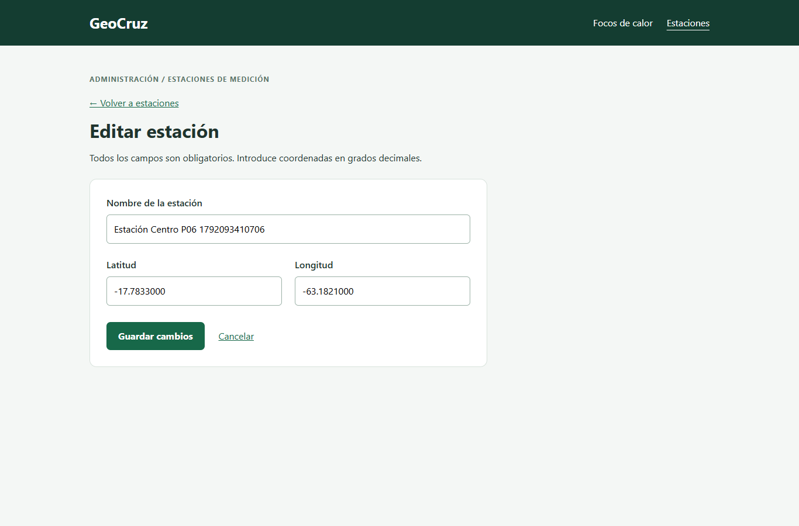
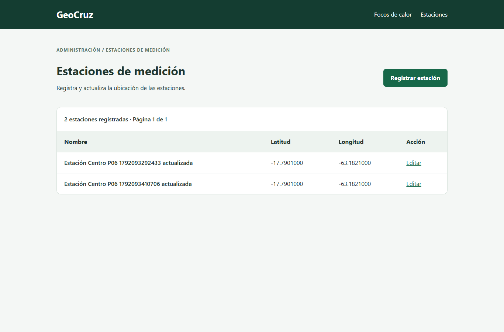

# P06 Registro de estaciones de medición

## Historia

Como administrador, quiero registrar estaciones de medición para asociar sus lecturas.

Issue: #4. Rama: `feature/4-web-registro-estaciones`, creada desde `origin/develop` en `90b737d`.

## Resultado

- Nombre, latitud y longitud obligatorios, validados en servidor y formulario.
- Persistencia mediante Eloquent y migración de la tabla `estaciones`.
- Listado ordenado y paginado, mensaje de lista vacía y enlace desde Focos de calor.
- Edición de una estación sin crear otro registro; datos originales conservados si hay errores.
- Latitud entre -90 y 90 y longitud entre -180 y 180. Se admiten coordenadas cero.
- Formularios con protección CSRF y salida HTML escapada.

## Cómo probar

Desde `web/`, con PHP y las dependencias de Composer disponibles:

1. Preparar la configuración local y una base SQLite o la conexión utilizada por el equipo.
2. Ejecutar `php artisan migrate`.
3. Ejecutar `php artisan serve` y abrir `/estaciones`.
4. Registrar una estación con nombre y coordenadas decimales. Comprobar el listado.
5. Pulsar Editar, cambiar nombre o ubicación, guardar y recargar. Comprobar los nuevos datos.
6. Dejar un campo vacío o enviar coordenadas fuera de rango. Comprobar el rechazo y la conservación de datos.

Pruebas automatizadas: `php artisan test --compact`. Resultado: 20 pruebas aprobadas y 115 comprobaciones, con SQLite en memoria. Incluye nueve pruebas de estaciones y once de incendios. Se retiró la referencia a la carpeta inexistente `tests/Unit` de la configuración de PHPUnit.

Recorrido automatizado con navegador: `node herramientas/verificar-estaciones.cjs`, con Playwright instalado. `GEOCRUZ_URL` permite indicar la URL local y `GEOCRUZ_NAVEGADOR` el ejecutable del navegador. Registra datos de prueba en la base local; usar una base destinada a pruebas. Comprobó registro, listado, edición, persistencia tras recarga y formulario de 390 px sin desbordamiento.

## Evidencia

Resultado del recorrido: `evidencias/p06-estaciones/recorrido.json`.

## Alcance de la práctica

La base existente no incluye acceso de usuarios ni roles; esta práctica no implementa autenticación o autorización de administradores. La asociación de lecturas y la eliminación de estaciones quedan fuera de los tres criterios solicitados. El registro no crea sensores ni lecturas ambientales reales.

La revisión P07 y la aprobación del pull request corresponden al compañero. No se registra aprobación ni merge anticipados.
